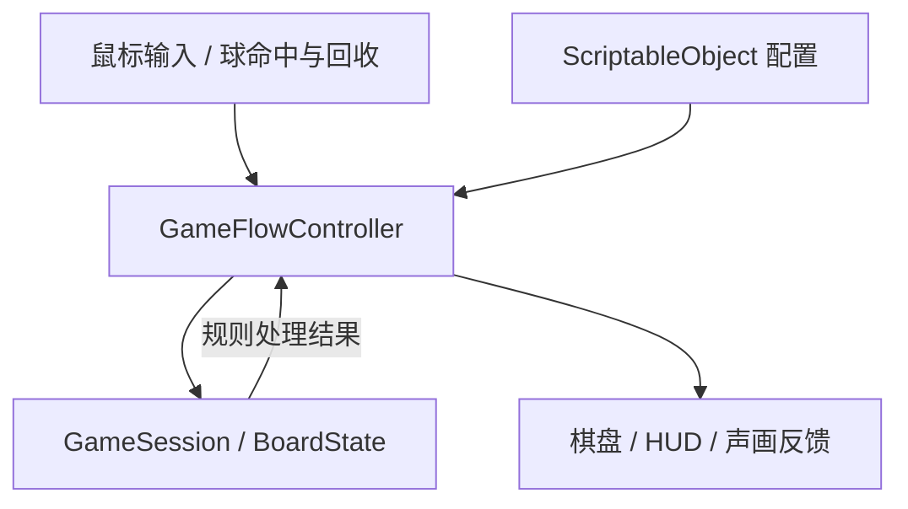
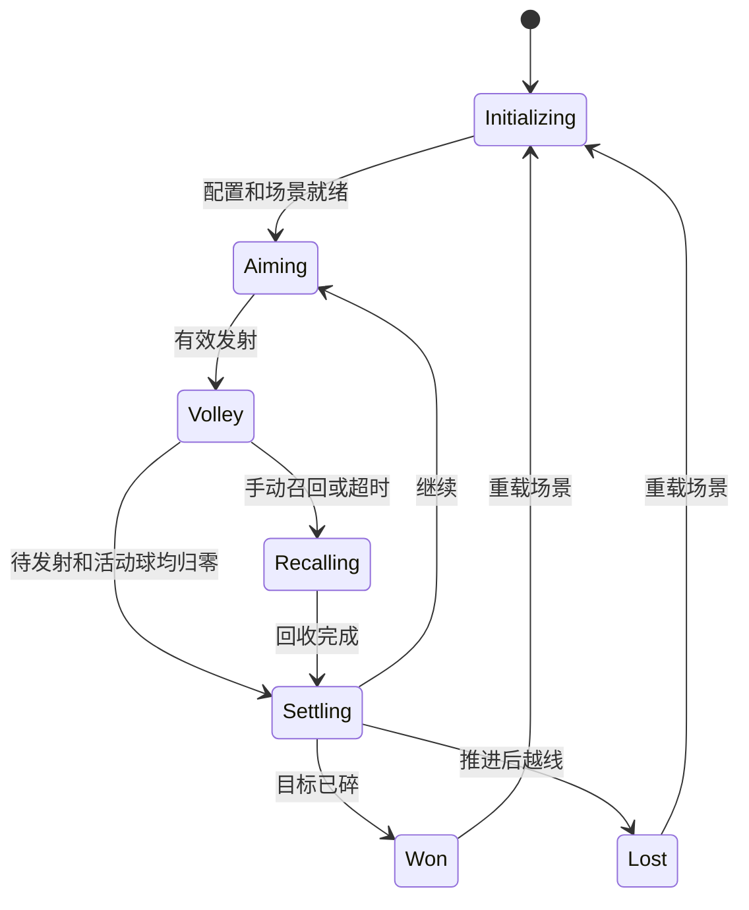

# Holedown 类 Jam MVP：技术方案与执行规范

日期：2026-10-30。面向负责实现的工程师或 agent。

先阅读 [产品设计](产品设计.md)。产品规则、场地、默认参数及演示关卡以该文档为准；本文确定架构、接口、实施顺序与验证要求。

**强制要求：每完成一个独立、可验证的改动，先执行对应自测；通过后提交一次 Git，再开始下一项。禁止把多个已完成改动积攒到最后统一测试和提交。**

## 1. 当前工程与实施边界

检查时间：2026-10-30，文档落盘前的工程状态。执行 agent 启动时重新核对现场。

| 项目 | 当前事实／约束 |
|---|---|
| Unity | 6000.4.3f1，保持当前版本 |
| 渲染 | URP 17.4.0，已有 Renderer2D 配置 |
| 输入 | Input System 1.19.0，`activeInputHandler=1` |
| UI | UGUI 2.0.0 |
| 测试 | Unity Test Framework 1.6.0 已列入依赖 |
| 玩法实现 | Assets 中暂无玩法 C# 脚本；现有 SampleScene 为起点 |
| 时间步长 | 当前 Fixed Timestep 为 0.02 秒 |
| Git | 当前 main 尚无首次提交；已有暂存、未暂存及未跟踪内容 |

复用现有 2D 渲染配置和空场景。首版保持当前引擎与包版本，使用内置 Rigidbody2D／Collider2D 物理、UGUI 和新 Input System。

交付 Windows x86_64 运行包，采用 Mono 后端；S0 检查对应构建支持是否可用。构建环境缺失时作为环境阻塞单独报告。

## 2. 已确认的架构与模式

**轻量分层 + Unity 组件组合，以有限状态机驱动回合。**

### 2.1 模块职责

| 层／对象 | 职责 | 数据所有权 |
|---|---|---|
| 规则层：`GameSession` | 管理流程状态、回合编号、待发射数量及活动球登记 | 当前局和回合 ID、状态、待发射数量、活动球 ID 集合 |
| 规则层：`BoardState` | 方块扣血、布局推进、补行、目标和越线判定 | 方块 ID、行列、宽度、血量、目标标记、补行游标、目标击碎标记 |
| 流程层：`GameFlowController` | 协调输入、发射、碰撞结果、回收、结算与重开 | 协程句柄、运行时组件引用；不复制一份规则层状态 |
| Unity：`AimInput` | 鼠标读取、UI 过滤、方向约束、瞄准预览 | 临时输入与显示数据 |
| Unity：`BallActor` | 单球物理运动、命中报告和回收报告 | 球的物理对象、所属局／回合／球 ID |
| Unity：`BoardView`、`BlockView` | 创建并更新方块、碰撞体和血量文字 | `blockId → BlockView` 映射；BlockView 不持有可独立修改的血量 |
| Unity：`HudView`、`FeedbackPlayer` | 界面、闪白、音效与碎片 | 纯表现状态 |
| 配置：`GameSettings`、`LevelDefinition` | Inspector 参数与关卡定义 | 原始定义；运行时保持不变 |

规则层为普通 C#，不引用 Unity API。Unity 坐标、碰撞体和屏幕坐标换算位于组件层；规则层只处理格子与规则数据。

### 2.2 采用的模式与组织方式

| 方式 | 确定用法 |
|---|---|
| 有限状态机 | `enum + switch`，状态由 GameSession 保存，通过合法转换方法修改，流程控制器负责调度 |
| 观察者模式 | 局部 C# `event`；显式订阅与取消订阅，用于球事件和表现通知 |
| 组件组合 | 输入、物理、棋盘显示、HUD、反馈分别由组件承担 |
| 手动依赖注入 | MonoBehaviour 使用 Inspector 引用；普通 C# 对象通过构造函数接收数据 |
| 数据驱动 | ScriptableObject 保存定义，开局时创建独立运行时数据 |

有限状态机是流程模型，数据驱动是配置方式。首版按上述尺度组织代码，依赖通过明确引用传递。

### 2.3 单向数据流

输入和物理组件报告事实，规则层决定状态变化，流程层先落实碰撞体与画面变化，再发出表现通知。音效或粒子播放失败不影响伤害和胜负。

## 3. 数据与接口约定

### 3.1 配置与运行时模型

- `GameSettings`：球数、半径、球速、发射间隔、角度限制和自动召回时间。场地几何采用产品设计的固定默认规格。
- `LevelDefinition`：初始方块列表与有序补行列表。初始块包含行号；补行块固定加入第 0 行。块定义包含起始列、宽度、血量和目标标记。
- `BoardState`：开局复制配置数据，为方块分配局内唯一 ID。目标块归零时保留独立的目标击碎标记，显示对象销毁不会丢失胜利依据。
- `GameSession`：初始处于 Initializing。每次接受有效发射时增加回合编号，初始化待发射数量，并使用新的回合 ID。
- 所有配置资产在运行时保持原值；重开从相同定义重新生成状态。

### 3.2 对外入口与关键交互

| 接口／事件 | 行为约定 |
|---|---|
| `GameFlowController.TryFire(Vector2 direction) → bool` | 只在 Aiming 接受有效方向；立即锁定方向、进入 Volley 并启动连续发射 |
| `RequestRecall()` | 只在 Volley 生效；进入 Recalling，取消剩余发射，回收活动球；重复调用无额外效果 |
| `Restart()` | 停止当前流程，重新加载本场景 |
| `BoardState.ApplyHit(blockId) → HitResult` | 返回是否接受命中、剩余血量、是否击碎、是否目标块；不存在或已归零的块拒绝重复受伤 |
| `BoardState.Advance() → BoardAdvanceResult` | 上移现有块、补入下一行，返回布局变化及越线结果 |
| GameSession 的发射登记 | 每实际发出一球，将待发射数减一、登记活动球 ID；在球激活前完成登记 |
| GameSession 的回收登记 | 从活动集合移除球 ID；同一 ID 的重复回调不重复减少数量 |
| `BallHit` | 携带 `sessionId、volleyId、ballId、blockId` |
| `BallReturned` | 携带 `sessionId、volleyId、ballId` |

事件收到后先校验所属局、回合及当前状态。过期球事件不改变新回合。命中只在 Volley 中处理，Recalling 和终局期间不继续造成伤害。

### 3.3 配置校验

初始化时验证：列号和初始行号合法、宽度仅为 1 或 2、血量大于 0、方块占格不重叠、补行顺序有效、目标块唯一且位于最后一条补行中。

球数、半径、球速、发射间隔和超时时间均须大于 0；角度限制须保持向下分量。球半径须适配场地及关卡空隙。

配置无效时显示初始化失败信息、在 Console 中记录原因并禁止发射，不能进入损坏对局。

## 4. 回合与生命周期

### 4.1 状态机

Volley 同时覆盖依次发射和飞行阶段。状态机使用 enum 和集中处理的 switch，只有 GameSession 的合法转换方法可以改变流程状态。

### 4.2 连续发射与回收

1. 接受输入时立即离开 Aiming，防止同帧重复发射。
2. 发射协程保存局 ID、回合 ID 和点击时的方向。
3. 每次生成球前检查身份、当前状态和待发射数量。
4. 实际发球时先登记，再激活球。活动球集合是数量依据，HUD 只读取它。
5. 自然回收、手动召回、超时及异常出界共用同一套回收登记入口。
6. 待发射数和活动集合都为空时请求结算；在 LateUpdate 的统一调度点执行。

### 4.3 召回与结算

- 召回首先切换到 Recalling，将待发射数量置零并停止发射协程，然后逐个回收活动球。
- 自动兜底从接受本轮发射时累计游戏时间，阈值默认 30 秒，复用召回流程。
- 进入 Settling 的状态转换充当一次性门禁，重复回收不会再次触发推进。
- 结算严格遵循产品设计：目标已碎则判胜；否则上移补行，再检查危险区域。
- 棋盘只在球全部清理后移动，不能在任意碰撞回调里直接推进。

### 4.4 重开与清理

首版采用场景重载。停止发射及表现协程，取消事件订阅，清理运行时球和方块；新场景重新创建 GameSession 和 BoardState。

本版没有跨场景常驻游戏状态。新局采用新的局 ID，旧对象的延迟回调即使到达，也会因身份不匹配被拒绝。

## 5. Unity 组件实现约束

### 5.1 球、墙与方块

- 球使用 Dynamic Rigidbody2D 和 CircleCollider2D，关闭重力、线性阻尼和角阻尼，冻结旋转，开启连续碰撞检测。
- 使用 `Rigidbody2D.linearVelocity` 初始化运动，在 FixedUpdate 校正非零速度的大小，保持当前物理方向。
- 球、墙和方块统一使用摩擦 0、弹性 1 的 PhysicsMaterial2D。反弹交给物理引擎，避免再手动反射一次。
- 球与球关闭碰撞；球与墙、方块开启碰撞。表现碎片不进入这些碰撞层。
- 仅由 BallActor.OnCollisionEnter2D 报告块命中；按一次接触事件扣血，不按接触点数或 OnCollisionStay2D 帧数扣血。
- 方块归零后立即禁用碰撞体，再播放碎片和销毁显示对象；同一物理步中其余命中也须经过规则层存活检查。
- 顶部回收以向上运动且越过回收线的位置检查实现，避免只依赖薄 Trigger。异常出界或近零速度的球使用统一入口单独回收。
- BoardView 按 blockId 保存显示对象映射，推进时更新位置，补行时创建新块。移动后同步 2D 碰撞体，再开放瞄准。

参考：[连续碰撞检测](https://docs.unity3d.com/6000.4/Documentation/ScriptReference/CollisionDetectionMode2D.Continuous.html)、[linearVelocity](https://docs.unity3d.com/6000.4/Documentation/ScriptReference/Rigidbody2D-linearVelocity.html)、[Physics Material 2D](https://docs.unity3d.com/6000.4/Documentation/Manual/2d-physics/physics-material-2d-reference.html)、[SyncTransforms](https://docs.unity3d.com/6000.4/Documentation/ScriptReference/Physics2D.SyncTransforms.html)。

### 5.2 输入与瞄准

- 通过新 Input System 的 Mouse 在 Update 中读取位置及本帧左键按下状态；鼠标设备不存在时不接受发射。
- 按游戏相机将屏幕位置映射到棋盘平面。无效方向按产品规则处理；有效方向限制在正下方左右 75°。
- 用与实际球半径一致的 Physics2D.CircleCast 预览第一次碰撞，查询层只包含墙和方块。
- 预览线终点使用命中结果的 centroid，即球心到达位置；没有命中时显示到有限的场地预览距离。
- 对交互 UI 执行当前指针位置的 EventSystem.RaycastAll 检查，避免按钮点击穿透；纯装饰图形关闭 Raycast Target。
- 不在 InputAction 的 performed 回调内依赖上一帧 UI 命中状态。发射权限最终仍由 TryFire 校验。

参考：[Mouse](https://docs.unity3d.com/Packages/com.unity.inputsystem@1.19/manual/Mouse.html)、[CircleCast](https://docs.unity3d.com/6000.4/Documentation/ScriptReference/Physics2D.CircleCast.html)、[Input System UI 支持](https://docs.unity3d.com/Packages/com.unity.inputsystem@1.19/manual/UISupport.html)。

### 5.3 场景、相机、UI 与反馈

- 复用现有空 SampleScene，配置为 Windows 包的启动场景。游戏对象通过 Inspector 明确绑定。
- 正交相机保持棋盘完整可见；窗口比例变化时根据棋盘宽高和留白计算所需 orthographicSize，坐标换算使用实际游戏相机。
- UI 使用 UGUI、TMP 和 InputSystemUIInputModule；导入并提交实际依赖的 TMP Essential Resources 及其 .meta。
- 灰盒短文案采用产品设计约定的英文；纯表现反馈通过局部 C# event 触发。
- 音效统一限频到最短 0.05 秒；同帧大量命中不能无限叠加音量。可使用简单的运行时合成占位音，避免依赖外部下载。
- 数字立即刷新，闪白和碎片不阻塞规则执行。动画只作用于视觉子对象，不缩放 Collider 所在对象。
- 缓存常用组件引用；OnEnable 订阅、OnDisable 取消订阅；所有延迟任务都必须能在召回或重开时停止或失效。

## 6. 开发顺序与时间预算

每个步骤的预算已包含对应自测和提交。阶段内若产生额外独立修复，仍须分别自测、提交。

| 步骤 | 预算 | 交付和自测 | 提交主题示例 |
|---|---|---|---|
| S0 工程基线 | 0.25h | 核对 Git 状态；确认空场景可 Play、Console 无阻塞错误；确认 Windows 构建环境 | `chore: establish Unity project baseline` |
| S1 配置与规则 | 1h | 配置资产和运行时模型；测试扣血、推进、目标、越线及数据校验 | `feat: add MVP rules and level definitions` |
| S2 场地与单球 | 1.5h | 墙、方块、单球和预览；测试反弹、扣血、回收及高速碰撞 | `feat: add ball physics and aiming preview` |
| S3 回合生命周期 | 1.5h | 连发、登记、召回及超时；测试提前回收、取消发射和重复回调 | `feat: add volley lifecycle and recall` |
| S4 完整关卡 | 1h | 绑定预设补行、胜负和重开；走通成功与失败路径 | `feat: complete level progression and restart` |
| S5 最低表现 | 0.75h | HUD、闪白、碎片及简单音效；测试 UI 穿透和文字可读性 | `feat: add MVP HUD and feedback` |
| S6 集成与构建 | 1h | 策划试玩调参、完整回归及 Windows 包验证；必要的配置修改测试后提交 | `chore: validate Windows MVP delivery` |
| 修复预留 | 1h | 修复已发现问题，重跑受影响测试；每次独立修复单独提交 | `fix: describe the verified issue` |

提交主题是命名示例，不要求在没有文件变化时创建空提交。实际提交描述最终改动内容。

## 7. 每次改动的自测与 Git 规范

### 7.1 强制闭环

**一次独立改动 → 对应自测 → 修复并复测至通过 → 一次 Git 提交 → 开始下一项。**

“一次改动”指一个明确目的、能独立验证的工作单元，包括功能、修复、关卡参数、Prefab、配置和文档。不是按每行输入或每次保存计算。

1. 开始前明确本次目的、影响范围和验收点，查看当前 Git 状态。
2. 完成后检查差异；代码变动须通过 Unity 编译，相关 Console 错误须处理清楚。
3. 执行受影响的自动测试和对应 Play Mode 操作。文档修改检查内容及引用，关卡参数修改检查数据和实际试玩结果。
4. 自测失败时先修复并重测，不能把失败项标记为完成，也不能跳到下一项掩盖问题。
5. 通过后立即提交本次改动，提交正文记录目的、自测方式和结果。
6. 提交完成后交接 commit hash、已测范围和剩余问题。

每次执行匹配改动范围的测试；最终交付再跑完整回归。环境缺失导致不能执行的测试必须明确标记，不能宣称通过。

### 7.2 提交范围与基线

- 当前仓库尚无首次提交，且索引与工作树已有差异。S0 先记录和核对这些状态，单独建立当前工程基线；已有改动明确列作基线，不包装成本次 MVP 功能。
- 按当前工作树实际状态处理已删除文件，避免把暂存区的旧脚本版本意外提交回工程。
- 保留既有工具配置；来源无法确认的既有文件保持原样并单列交接，不混入功能提交。
- 功能开发使用 `codex/holedown-mvp` 分支。
- 每次显式选择本次文件及对应 .meta，检查最终提交差异，避免未经检查的整库暂存。
- 缓存、日志、构建产物和本机连接信息不纳入功能提交；遵循现有 .gitignore 和 .gitattributes。
- 不清空用户现有工作，不强制覆盖，不改写已有历史。
- 自测记录可放在提交正文；长测试日志作为本地产物保存，交接时给出可访问位置。

## 8. 测试计划与完成标准

以下是待实施的验收要求，不代表这些测试已经执行。

### 8.1 规则层自动测试

使用现有 Unity Test Framework，规则层以 Edit Mode 测试覆盖行为边界：

- 同一方块多次受击正确扣血，归零后不产生负血量或重复击碎。
- 一格及双格占格正确，上移后位置一致，非法布局被拒绝。
- 补行顺序正确，耗尽后不重复生成目标。
- 活动球暂时为零、但仍有待发射球时不允许结算。
- 重复回收、重复召回、过期回调和重复结算请求不导致多推进一轮。
- 目标已碎且推进原本会越线时，优先胜利且不推进。
- 安全行第 7 行不判负，推进到第 8 行才进入危险区域。

为运行时代码和测试配置明确的程序集引用，测试程序集不进入 Player。只为规则和生命周期风险编写有意义的测试，简单表现调整使用对应操作自测。

### 8.2 Play Mode 与 Windows 包

| 场景 | 验收标准 |
|---|---|
| 垂直、斜向及贴边射击 | 反弹正常，预览与首次接触一致 |
| 默认球速和两倍球速 | 测试路径中没有穿墙、穿块或永久卡球 |
| 多球同时命中低血量块 | 只击碎一次，后续球不继续撞已禁用的碰撞体 |
| 发射尚未完成时召回 | 后续球停止生成，保留已造成伤害，只结算一次 |
| 自然回收与自动超时 | 均可进入下一轮或正确结束游戏 |
| 点击召回与重开 UI | 不产生额外发射 |
| 胜利、失败后连续重开 10 次 | 没有残留球、旧回调、重复订阅或异常 |
| 720×1280 与 1280×720 窗口 | 棋盘完整可见，鼠标瞄准位置正确 |
| Windows 包独立启动 | 无需 Editor 即可完成一局、重开，字体与反馈资源正常 |

### 8.3 最终交接

- 运行方式及启动场景。
- Inspector 参数和预设关卡编辑说明。
- Windows 包所在位置及启动方式。
- 逐项自测结果，未执行或未通过项目单独列明。
- 对应 commit hash，以及当前残留的既有工作区变更说明。
- 策划对钻缝、多次反弹和连续击碎体验的试玩结论。

完成标准：产品闭环可玩、关键测试通过、每次独立改动均已自测并提交。交付前不新增已排除的产品功能。
