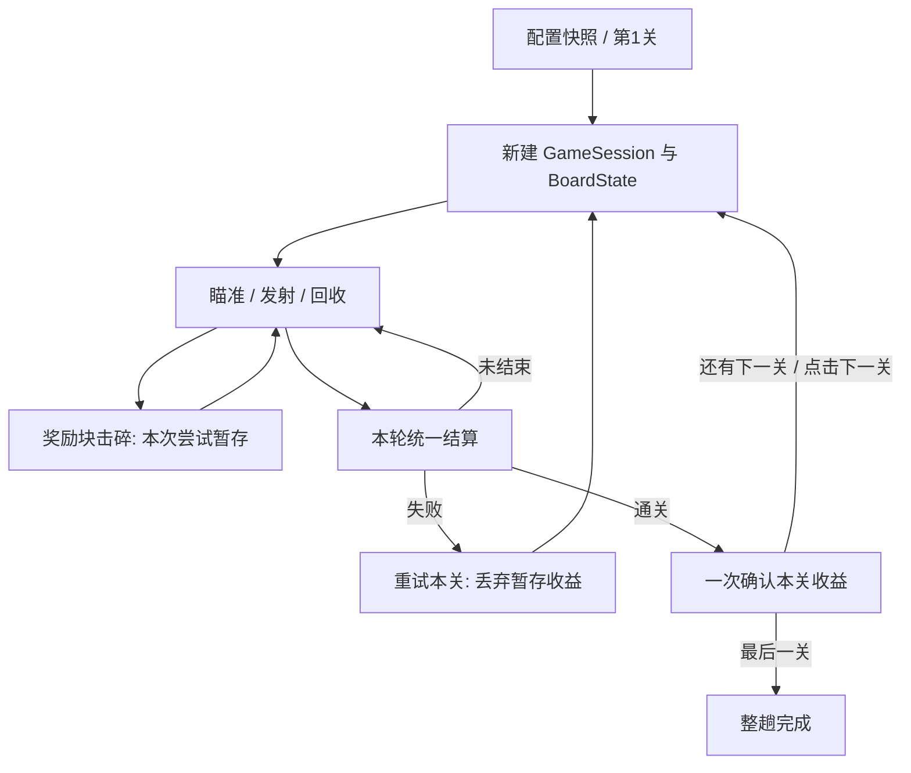

# 成长版：架构增量、调参工具与执行验收

日期：2026-11-01。状态：供其他工程师或 agent 执行的计划，本文所列新增功能尚未实施。

先阅读 [产品设计](产品设计.md)。原 [MVP 技术方案](../MVP/技术方案.md) 的轻量分层、组件组合、有限状态机、局部事件、手动依赖注入和数据驱动继续适用。

2026-11-02 后续阶段：本轮成长功能已有交付说明，脚本现位于 Assets/Holedown/Scripts。下一轮只做美术样片适配与最简开始页，实施依据见 [美术接入技术方案](美术接入技术方案.md) 和 [素材交接](../../VISUAL_DESIGN.md)；下文保留此前计划的历史状态，不作为新增实现已经完成的证明。

2026-11-02 输入补充：已确认左键发射、Space 召回、Esc／HUD 暂停、失焦保护及暂停层重载。产品规则、架构增量和逐项自测提交要求见 [玩家输入方案](玩家输入方案.md)；与开始页适配协同实施，尚未实现。

**工作闭环：一次独立改动 → 对应自测 → 通过后一次 Git 提交 → 下一项。不能以时间紧为由跳过自测、提交或最终构建验证。**

## 1. 当前事实与增量边界

文档编写时分支为 codex/holedown-mvp，最新提交 b0244f9。已有可运行单关、外置两份 JSON、离线编辑器、重载按钮及测试基础。

- GameFlowController 每轮直接用 Settings.ballsPerRound，没有多关或成长状态；Restart 重新加载场景。
- GameSession 只管理关内状态、发射和回收。BoardState 目前只有 width，没有 height、奖励或最大血量。
- 现有补行始终从 row=0 生成，高度为 1；增高补行会引入跨批次重叠，因此本计划不开放。
- 当前工具方块血量需要手动保存，未保存就切块或导出可能丢失编辑；没有批量或撤销／重做。
- 历史交付记录为 EditMode 32/32、PlayMode 19/19、Node 16/16，通过真实浏览器和 Player 操作；这是历史结果，本轮文档工作没有重新运行这些测试。

沿用 Unity 6000.4.3f1、URP 17.4.0、Input System 1.19.0 和现有物理方案。P0 优先成长与工具，P1 为竖块、缩放和裂痕，爆炸与穿透不进入本轮实现。

## 2. 架构与职责

### 2.1 在既有规则层上增加整趟状态

| 对象 | 职责与数据边界 |
|---|---|
| 新增 CampaignDefinition／StageDefinition | 普通 C# 只读配置快照：有序关卡、ID／名称、初始块和补行；与运行时伤害分开 |
| 新增 CampaignState | 普通 C#：当前关序号、基础球数、入关球数、已确认成长、本次尝试待结算奖励、当前关是否已完成 |
| 保留 GameSession | 继续是单次关卡尝试的状态机；每次切关或重试创建新实例及 SessionId |
| 扩展 BoardState／BlockState | 保存奖励属性；P1 保存高度和初始最大血量，进行完整占格和越线判断 |
| 扩展 GameFlowController | 协调整趟、关卡尝试和 Unity 对象生命周期，处理切关／重试／重载，不复制一份球数成长状态 |
| 扩展 LoadedConfiguration | 持有隔离的基础设置及全部关卡定义，按索引创建全新的 BoardState；不再将唯一可变 Board 当成完整配置 |
| 扩展 HUD／ResultView | 展示当前关、入关能力与待结算收益，调用流程命令；不计算奖励 |

配置基础球数不因奖励而改变，不能直接改 ScriptableObject 或 Settings.ballsPerRound 来实现成长。每轮 TryFire 使用 CampaignState.EntryBalls。

Unity Editor 可继续使用原单关 Inspector 回退；三关集成测试使用现有 externalConfigDirectory 指向新 JSON。首日不额外开发 Unity 内多关编辑器或新资产管理系统。

### 2.2 状态与奖励流

GameSession 原有 Initializing、Aiming、Volley、Recalling、Settling、Won、Lost 保留。CampaignState 管跨关数据，关内每轮仍由原状态机控制。

### 2.3 接口增量

| 接口／属性 | 确定语义 |
|---|---|
| CampaignState.EntryBalls | 当前关固定球数，等于本次入关时的基础球数加已确认成长 |
| CampaignState.PendingBonus | 本次关卡尝试中已击碎奖励，尚未通关确认的值 |
| CampaignState.CompleteStage() | 只接受当前关首次完成；将暂存收益确认一次，进入已完成状态；本关 EntryBalls 不回写变化 |
| GameFlowController.NextStage() | 只在非最终关已通关时生效；推进关序号，创建新关尝试，按已确认成长确定新 EntryBalls |
| RetryStage() | 只在本关失败时生效；保留入关能力，丢弃本次暂存奖励，重建当前关 |
| RestartRun() | 清空成长，从第 1 关重建，使用当前已加载快照 |
| ReloadAndRestart() | 终止当前整趟，重新读两份文件，重新开始；原 Restart() 保留为此行为的兼容入口 |
| LoadedConfiguration.CreateBoard(stageIndex) | 每次返回独立 BoardState，不能复用已受伤或已推进的上一尝试 |
| HitResult.RewardBalls | 只在有效击碎奖励块时返回 3 或 5，其他情况为 0；现有 Accepted／Destroyed 等含义保留 |

GameFlowController.Board 继续公开当前关 Board，兼容现有 HUD 和操作测试。依赖旧 LoadedConfiguration.Board 的测试和调用点随配置快照接口一起更新。

### 2.4 幂等与生命周期

- BoardState.ApplyHit 是奖励产生源；已删除方块不再产生有效结果。奖励更新在规则／流程层处理，不挂到 FeedbackPlayer 的粒子或音效事件上。
- 只有通过现有 SessionId／VolleyId／活动球校验的事件可产生伤害与收益。
- GameSession 本轮结算后首次进入 Won 时调用 CompleteStage。重复结算或重复下一关不能再次确认收益。
- 目标已碎后仍允许本轮剩余球产生合法伤害；结算时封账。进入结算／召回后拒绝新的迟到伤害。
- 切关和重试复用统一初始化入口：锁输入、停发射、解绑并清理球、清理表现、重建棋盘、新建 GameSession、配置瞄准、Ready、通知界面。
- 切关和重试不重新加载场景，CampaignState 留在当前控制器内；不依赖静态变量或跨场景单例保留成长。
- 完整配置重载可继续使用原场景重载路径，使旧快照释放，新快照重新加载。
- 过渡命令立即进入不可重入状态；按钮重复点击仅第一次生效，订阅不能在每次 Refresh 时重复增加。

## 3. 配置版本与兼容

仍然只有 settings.json 与 level.json，文件位置和策划手动替换流程保持不变。

### 3.1 格式定义

| 数据 | 字段与要求 |
|---|---|
| settings.json | schemaVersion 仍为 1；原字段和范围不变，ballsPerRound 是整趟基础球数 |
| level.json v2 | 根字段固定为 schemaVersion=2、version、levels；levels 是非空有序数组，交付示例有 3 项 |
| 每个关卡 | id、name、initialBlocks、incomingRows；id 为唯一的 1–32 位字母／数字／点／下划线／连字符，name 为 1–40 字符的编辑器名称 |
| v2 方块 | column、row、width、height、health、target、rewardBalls；height 在 P0 必须为 1，rewardBalls 只能为 0、3、5 |
| 补行 | 沿用每项包含 blocks 数组的结构，row=0、height=1 |
| 块类型 | target=true 时 rewardBalls 必须为 0；rewardBalls>0 表示奖励块，其余为普通块 |

各关沿用唯一目标位于最后补行的规则。每个非最终关奖励块总数不超过 1，最终关为 0。检查基础球数加所有可能奖励不超过正 32 位整数范围，不能溢出回绕。

严格检查未知／缺失字段、类型、范围、重复键、重叠及目标约束。错误路径包含关卡索引，例如 levels[1].initialBlocks[2].health。

### 3.2 旧配置处理

- settings v1 + level v1 继续接受；将旧关卡转换为一关快照，height=1、rewardBalls=0，不生成成长。
- 新工具导入旧单关后在内存中规范化为 v2；再次导出为 v2，不自动覆写源文件。不保证旧程序可以读取新 v2 文件。
- settings 的 schemaVersion=2 仍须拒绝，不能因为 level 支持 v2 而全局放宽所有文件版本。
- 两文件都缺失时保持原内置单关回退，HUD 标明 Stage 1/1 与 Built-in；只缺一个或内容非法时明确报错，不混用默认值。
- 文件只在启动或 ReloadAndRestart 时读取；RetryStage、NextStage、RestartRun 使用内存快照。

默认三关 JSON 按产品设计第 6 节的基准提交及变换生成，源码 Config、工具 defaults 和交付包三者必须一致。Inspector 原单关资产作为兼容回退保留。

## 4. 离线策划工具的实现组织

保持现有原生 HTML／CSS／JavaScript 和 file:// 打开方式，不增加打包步骤或在线依赖。

### 4.1 模型与编辑状态

- config-model.js 负责 v1／v2 识别、规范化、规则校验和放置判断。
- 新增 editor-state.js 管理事务、撤销／重做和所选关卡／布局上下文；同时保留浏览器全局和 Node 可测试导出方式。
- editor.js 负责 DOM 绑定与渲染，不自行再实现一套占格或奖励规则。
- 保留 validate(settings, level) 的字符串错误数组接口；增加结构化错误入口供 UI 定位，二者来自同一份校验结果。
- C# 与 JS 使用共同的正反例配置夹具，验证格式、奖励、目标和形状约束一致。

关卡名称在工具展示；游戏 P0 仅显示 Stage i/N 等英文短标签，不额外引入中文游戏字体。

### 4.2 数值提交与未应用输入

血量和基础球参数使用失焦／Enter 提交。合法字段值落入编辑模型、记录事务、刷新统计与棋盘；非法值留在控件草稿中，模型保留上次有效值。

存在非法未应用输入时，全局状态必须包含它，不能仅因模型旧值合法就允许导出。切换块／布局／关卡或导出先阻止并定位该输入，提供恢复上次有效值的取消操作。

位置、尺寸和块类型继续通过明确的属性应用动作提交。完整项目可因移动目标等操作暂时不合法，但这种状态必须被校验和导出门禁识别。

编辑器角色选择呈现普通／奖励／目标，避免让策划同时勾选相互冲突的属性。奖励显示 +3／+5 下拉框；最终关禁用奖励选项并说明原因。

### 4.3 批量操作与历史

- 多选通过数值表复选框实现，范围限定当前关、当前布局；换布局清空选择，不提供跨关隐式选择。
- 普通块全选不包含目标和奖励，特殊块可以显式勾选；确认摘要分别显示各类数量。
- 设值 N 为正整数；加减 N 为整数，允许负数。先计算全部结果，有非正值或溢出则整批拒绝并定位，不能部分应用。
- 一次单值提交、块／补行结构操作或批量操作对应一次事务。历史保存完整配置快照及关联编辑上下文，最多 50 次，属于当前页面会话。
- 撤销／重做恢复完整操作，更新校验、选择和修改状态；撤销后再编辑会清空重做栈。
- 导入成功或还原示例替换当前项目前提示未导出修改；替换成功后开启新的历史。导入失败不能污染当前配置。
- 输入框正在编辑时保留浏览器原生文字撤销；工具级撤销／重做提供明确按钮，避免劫持所有文本快捷键。

### 4.4 工具状态与导出

- 记录两份文件各自的导入基线及最近一次请求导出的内容快照；数值改变后重新计算状态，而不是仅保留一个全局 dirty 布尔值。
- 状态文案采用“未修改／有未导出修改／已请求导出，请核对下载”，不宣称已经写入 Config。
- 保留手填版本，提供生成版本按钮，格式为本地时间 yyyyMMdd-HHmmss-SSS，符合原版本字符限制。
- 当前完整校验或未应用输入有错误时禁用导出；错误可跳到对应文件／关卡／布局／块／字段。
- 下载仍使用原有文件名；继续提示浏览器可能添加 (1)，以及手动替换后需主动 Reload + Restart。
- 显示当前布局总血量、块数；入关球数范围按基础球数与前序可选奖励计算，不能固定假定奖励全拿。

基础球参数保留中文单位，数值表为主调参入口，属性面板负责空间布局。沿用现有配色和响应式布局，清晰显示当前关卡与布局，减少页面上下往返。

## 5. P1 合同：竖块与裂痕

### 5.1 竖向双格

P1 才同时开放规则、运行时和工具中的 1×2；P0 的 v2 可包含 height 字段，但仅接受 1。不能先让工具导出运行时不支持的竖块。

- 允许形状仅为 (width,height)=(1,1)、(2,1)、(1,2)，不允许 2×2 或更大尺寸。
- 初始块满足 column+width≤8、row+height≤8；对完整矩形登记占格、检测重叠。
- 补行 height 必须为 1，维持每轮上移 1 格的规则。
- 越线检查改为 Row+Height-1≥8，避免竖块顶端越线却未判负。
- 中心为 (Column+Width/2, Row+Height/2)，视觉及 Collider 尺寸为 (Width-0.1, Height-0.1)。
- JS 棋盘格跨行显示、放置预览、校验定位与 C# 碰撞体同步更新；CircleCast 沿用实际 Collider。

### 5.2 裂痕与受击缩放

- BlockState 新增只读 MaxHealth，在初始创建时保存；受伤和推进不能覆盖。
- 外观按 Health/MaxHealth 重建：大于 2/3 完整，(1/3,2/3] 轻裂痕，(0,1/3] 重裂痕。
- BlockView.Bind 和每次血量更新都依据状态恢复裂痕，不能只在命中事件中切图。
- 视觉层分离基础图形、裂痕、数字、目标／奖励标记，后两者保持可读。
- 受击缩放仅作用于视觉子节点，0.04 秒缩至基础尺寸的 0.94，再用 0.08 秒恢复；重复命中从基准幅度重新计时，不能累积缩小。
- 沿用现有闪白、碎片和限频音效，不改变物理 Collider。美术用占位素材入口替换主题图，无需修改规则层。

## 6. 首日执行顺序与自测提交

| 顺序 | 预算 | 交付／验证 |
|---|---|---|
| 1 | 1.5h | CampaignState、奖励幂等及重试规则；规则单测通过后提交 |
| 2 | 1h | 配置 v2／v1 转换、快照和三关种子；C#／JS 夹具通过后提交 |
| 3 | 1h | GameFlow 切关、重试、从头开始和 HUD；PlayMode 生命周期用例通过后提交 |
| 4 | 2h | 编辑器多关、奖励、数值表、批量、撤销／重做、错误及导出状态；按独立改动分别自测提交 |
| 5 | 0.5h | 游戏加载浏览器导出数据，检查实际值、成长和快照；集成验证后提交对应修复或配置 |
| 6 | 1h | 全量回归、Windows 构建、独立包流程与分发编辑器验证 |
| 预留 | 1h | 修复与复测；不塞入额外玩法 |

时长为预算而非完成保证。第 4 小时核对 P0 链路；第 6 小时冻结新功能。P0 未完整通过时不得宣称首日完成，P1 默认另排后续工作。

一次改动指一个明确目的、可独立验证的工作单元，不是每行输入。代码改动通过编译和相关测试；关卡参数验证配置与实射；文档修改检查内容与引用。失败则修复重测，不把失败项标成完成。

自测通过后立即提交，正文记录目的、测试方式和结果；交接 commit hash。无法执行的测试单独说明，不能宣称通过。最终交付前完整回归。

当前仓库已经有初始及后续提交，不执行旧 MVP 文档中的“建立首次提交”步骤。检查现场状态后使用 codex/growth-planner 分支；仅显式提交本次文件及 .meta，不混入已有 UnityConnectSettings、Locus 或自动生成文件，不改写历史。

## 7. 测试与交付门禁

### 7.1 规则和配置

- +3／+5 完全击碎才暂存；同一块重复事件不重复奖励，本关每轮数量不变。
- 无奖励通关正常；连续获得 +3、+5 时入关为 12、15、20；末关不能配置奖励，目标与奖励互斥，每关最多一个。
- 拿奖励后失败重试回到入关球数，待结算清零；反复失败不能刷球；重复通关／下一关不能重复结算。
- 正常回收、召回、超时和目标优先判胜的原有行为不退化；目标击碎后本轮获得的合法奖励计入结算。
- v1 单关与 v2 多关、未知／缺失字段、重复键、非法奖励、整数溢出、目标位置和完整快照隔离覆盖。
- v2 只扩展 level 格式，settings v2 仍拒绝；文件缺失优先级不变。
- P1 增加竖块全占格、越界、最高行越线、补行竖块拒绝和裂痕阈值／MaxHealth 保持测试。

### 7.2 Unity 生命周期与 Player

- 连续切三关，前两关 Next Stage，末关完成；连续重试 10 次，无旧球、重复订阅和过期奖励。
- 验证进入下一关只改变后续每轮球数，不直接改变已发射或待回收球。
- 本关失败重试、整趟从头开始、飞行中主动重载分别验证；运行中改文件不影响快照，重载后版本和值生效。
- 实际半径、预览、默认和两倍球速回归；至少验证最大示例入关球数的连发与召回。
- UI 点击不穿透发射；结算和过渡按钮双击不跳两关。
- 三关以不拿奖励和拿奖励两类路线试玩，分别记录通关球数、回合与失败压力；不能用直接注入胜利代替全部实射。

### 7.3 真实浏览器

- file:// 打开，导入旧单关和新三关；切关／切布局后编辑内容正确。
- Tab／Enter 连续改血量；改完直接导出能得到新值，不再要求额外保存。
- 非法草稿不能切换后静默消失或导出旧值，取消可恢复上次有效值。
- 普通块全选范围准确，特殊块默认不选；明确勾选后才参与；非法批量完全回滚。
- 一次批量一次撤销，重做正确；撤销后新编辑清空重做；块／补行增删和奖励类型修改可恢复。
- 错误定位跨关／跨布局正确；两文件修改和导出请求状态独立更新，不误报“已写入游戏”。
- 下载后重新导入数值一致，游戏实际加载浏览器导出配置；不能只测编辑器自校验。

可复用现有 Node 模型测试和真实浏览器测试入口，更新旧字段断言及新增场景。保留原 MVP 回归，不把历史通过数量直接复制为新结果。

### 7.4 构建与发布

- 构建分发白名单增加 editor-state.js，保证源码工具与包内工具功能一致；更新快速上手。
- 构建继续保留输出目录已有 JSON，避免覆盖策划工作。正式交付使用新目录 Builds/Windows-Growth，并附新三关默认配置；旧 MVP 输出保留。
- 新分发包命名为 Builds/HoledownGrowth-Windows.zip，包含完整运行时、两份配置和离线编辑器，不包含测试程序集、日志或 DoNotShip 调试目录。
- 如输出目录已有配置，先备份并明确选择本次发布版本；不能因构建保留旧 JSON 而把单关包误报为三关。
- 在实际分发目录中重跑编辑器导入／改值／导出，并由独立 Player 读取；核对 S/L 版本、Stage 1/3、奖励和重试行为。
- 交接构建版本、配置版本、逐项测试结果、commit hash、P1 已交付／顺延状态和未通过项目。构建产物不提交 Git。

首日完成定义：P0 成长与调参闭环实际可用、关键验证通过、每次独立改动已经自测并提交；明确记录 P1 顺延，不以空接口或未验证选项冒充功能。
